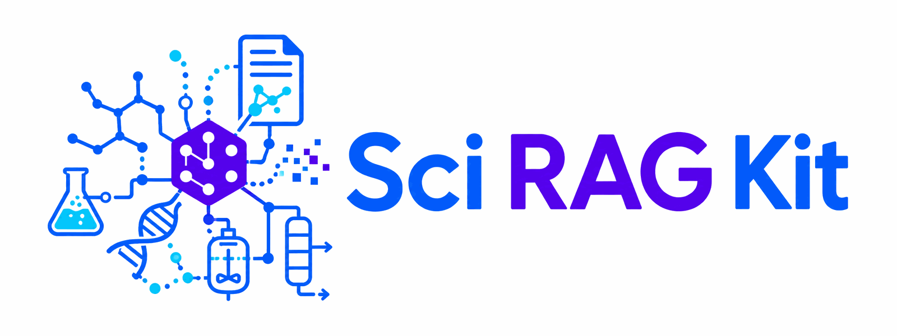

> **personal-agent fork.** This repository is the main home of the personal
> file memory system (PC-Mem): the sci-rag-kit knowledge base below, plus a
> GenericAgent memory face (`plugins/`, `memory/`) and the personal file space
> domain (`domain-personal/`). Migration provenance and exclusions: see
> [MIGRATION.md](MIGRATION.md). What follows is the upstream README.

<p align="center">
  
</p>

<p align="center">
  <a href="https://github.com/sustainability-software-lab/sci-rag-kit/actions/workflows/ci.yml"></a>
  <a href="https://sustainability-software-lab.github.io/sci-rag-kit/"></a>
  <a href="LICENSE"></a>
  
</p>

Retrieval-augmented generation, built around your scientific domain.

Sci RAG Kit is a project template for question answering over scientific
documents. It parses papers and reports, indexes their passages, runs five
kinds of search, and measures retrieval against questions with known answers.
With LLM provider credentials, it also builds a concept graph and writes answers
that cite the passages they use. REST and MCP clients share the same service.
Your project supplies the documents, the vocabulary of its field, and the
questions used to score the result.

Start a new project with two commands. `sci-rag new` asks a few questions and
writes a configured, git-initialized project directory:

```bash
pipx install sci-rag-kit
sci-rag new
```

To read the kit before creating a project, clone this repository and run the
demo corpus (see [Set up](#set-up)). The
[documentation site](https://sustainability-software-lab.github.io/sci-rag-kit/)
has the guided path. The [quickstart](docs/quickstart.md) takes about ten
minutes.

## Components

- **Ingestion.** PDF, HTML, Markdown, and plain-text files become passages
  that keep their section headings and their tables whole, so a value pulled
  from a results table still carries the heading that says what it measured.
  Each document also records its authors, its source, and whether its text
  may be redistributed, and a file ingested twice is recognized and skipped.
- **One database.** Passages, vectors, a full-text index, and the concept
  graph all live in PostgreSQL with the pgvector extension. That is a
  deliberate choice over a separate vector store or graph database: it
  leaves one thing to run, one thing to back up, and one place where a
  passage and its graph entries commit together.
- **A concept graph.** With LLM provider credentials, the kit reads every passage
  and extracts the concepts and relationships declared in
  `domain/domain.yaml`, then clusters related concepts and writes a summary
  of each cluster. The graph helps retrieve evidence when an answer spans
  several documents.
- **Five kinds of search.** By meaning, by exact words, through the concept
  graph, through the cluster summaries, and through a model-written
  hypothetical answer. Each finds evidence the others miss: keyword search
  catches an identifier that embeddings blur, and the graph reaches a passage
  whose words never appear in the question. The five result lists merge into
  one ranking, and every result names the layer that found it.
- **Cited answers.** The model answers from the retrieved passages only and
  cites each one by number, so a reader can check any claim against its
  source. When the documents cannot support an answer, the kit reports the gap.
- **Rights.** Every document carries a license class. A request that
  restricts rights never sees passages outside its scope, because the filter
  runs inside each search before ranking, so a shared endpoint cannot leak a
  paywalled PDF held internally.
- **Measurement.** A file of questions with known answers lets the kit score
  retrieval, grade generated answers, and report what each search layer
  contributes on the corpus at hand. Every report records the documents and
  models that produced it, so a number can be traced back to what it
  measured.
- **Serving.** One process answers the command line, a REST API with
  interactive docs at `/docs`, and agents over MCP, the protocol Claude Code
  and similar tools use to call external systems. All three go through the
  same service, so they cannot drift apart. API keys carry scopes and rate
  limits.
- **Models.** ModelScope supplies local Qwen3 embeddings and DeepSeek supplies
  generation by default. Google, Anthropic, and other OpenAI-compatible
  endpoints remain available, and the model that grades answers can differ
  from the one that writes them. `local-hash` provides an offline retrieval
  mode with no credential.

## Set up

Setup needs [uv](https://docs.astral.sh/uv/), Docker or a PostgreSQL 16
through 18 server with pgvector, and a generation credential. The default is
`SCI_RAG_DEEPSEEK_API_KEY`; Google credentials are an alternative path.

Create the local configuration file. The second command matters: the file is
about to hold a credential, and `cp` alone leaves it readable by every
account on the machine.

```bash
cp .env.example .env
chmod 600 .env
```

On Windows, reset the copied ACL before removing inheritance so no unrelated
explicit access rule survives:

```powershell
Copy-Item -Force .env.example .env
icacls .env /reset
icacls .env /inheritance:r /grant:r "$($env:USERNAME):(F)"
```

The default generation provider is DeepSeek. Set
`SCI_RAG_DEEPSEEK_API_KEY` to your key; the default base URL is
`https://api.deepseek.com`, and `SCI_RAG_DEEPSEEK_BASE_URL` overrides it.
Setting only a Google key does not switch the provider. To use Google, also
set `SCI_RAG_LLM_PROVIDER=google`.

| Setting | When to use it |
|---|---|
| `SCI_RAG_DEEPSEEK_API_KEY` | The shipped generation provider. |
| `SCI_RAG_GOOGLE_API_KEY` plus `SCI_RAG_LLM_PROVIDER=google` | Google AI Studio generation instead of DeepSeek. |
| `SCI_RAG_GCP_PROJECT` plus `SCI_RAG_LLM_PROVIDER=google` | Vertex AI generation for a project already using Google Cloud. Run `gcloud auth application-default login` first. |
| `SCI_RAG_EMBEDDING_PROVIDER=local-hash` | A credential-free retrieval pass. The graph and generated answers wait. |

To switch both generation and embeddings to Google, use this complete
provider set instead of setting only a key:

```dotenv
SCI_RAG_LLM_PROVIDER=google
SCI_RAG_LLM_MODEL=gemini-3.6-flash
SCI_RAG_EMBEDDING_PROVIDER=google
SCI_RAG_EMBEDDING_MODEL=gemini-embedding-001
SCI_RAG_EMBEDDING_DIM=1024
```

Then install, start the database, and run the demo:

```bash
make setup
make demo
```

`make setup` starts the selected database backend, installs the default
ModelScope and DeepSeek dependencies with
`uv sync --extra modelscope-embedding --extra openai`, and creates every
table. Docker is the template default. A project can instead use a conda-forge
server, a system PostgreSQL such as Postgres.app, or a Cloud SQL development
instance; [Configure Postgres backend](docs/run-postgres.md) covers each.

With a credential configured, the graph and the answers work too:

```bash
uv run sci-rag answer "What conversion route suits rice straw given its ash content?"
make demo-cloud        # build the graph, ask a multi-document question, score each layer
uv run sci-rag serve   # REST at /docs, MCP at /mcp
```

The demo corpus is five short synthetic documents about agricultural
residues, with plausible but fictional numbers. It exists so the pipeline
runs end to end before a real corpus goes in.

## Use your own documents

Put PDFs, HTML, Markdown, or text files in `data/raw/`, then run seven
commands. [Bring your own domain](docs/bring-your-own-domain.md) explains
each one.

```bash
uv run sci-rag draft manifest --folder data/raw      # 1. describe the documents
uv run sci-rag manifest lint data/corpus.jsonl        # 2. check the description, decide rights
uv run sci-rag draft ontology --folder data/raw       # 3. name the concepts your field cares about
uv run sci-rag build --manifest data/corpus.jsonl     # 4. ingest, then build the graph
uv run sci-rag draft questions --count 10             # 5. draft questions with known answers
uv run sci-rag eval retrieval --ablation              # 6. measure
uv run sci-rag answer "a question in your field"      # 7. ask
```

The three `draft` commands write a file to review, and each works without
LLM provider credentials: `--print-prompt` prints the prompt, and `--from-file`
reads the reply back. Printed prompts can contain sampled passages from your
corpus. Before sending one to an assistant, confirm that the documents'
rights, privacy requirements, provider terms, and institutional policy allow
that disclosure. Two things are never drafted: a document's rights, and the
human labels that check the answer grader.

For a first pass with no manifest, `uv run sci-rag build data/raw` ingests a
folder directly and builds the graph when a credential is present.

## Commands

`uv run sci-rag --help` groups every command by stage, and the
[CLI reference](docs/cli.md) lists every option. The commands most projects
use daily:

| Command | What it does |
|---------|--------------|
| `sci-rag new` | Create a configured project |
| `sci-rag doctor` | Check configuration, database, corpus, and credentials |
| `sci-rag build <folder>` or `--manifest file.jsonl` | Ingest documents, then build the graph |
| `sci-rag draft manifest`, `draft ontology`, `draft questions` | Draft the domain files from your documents |
| `sci-rag retrieve "question"` | Show the evidence, layer by layer |
| `sci-rag answer "question"` | A cited answer |
| `sci-rag eval retrieval --ablation` | Score retrieval and each layer's contribution |
| `sci-rag eval answers` | Generate and grade answers |
| `sci-rag campaign discover --topic ...` | Find papers to add, with their rights |
| `sci-rag serve` | REST and MCP server |
| `sci-rag stats` | What is in the knowledge base |

Register the MCP server with a local agent:

```bash
claude mcp add my-corpus -- uv run --directory /path/to/your/repo sci-rag mcp
```

## Repository layout

```
domain/            The field: concepts, prompts, test questions
data/raw/          The documents; data/corpus.jsonl describes them
data/demo/         The demo corpus (synthetic, CC0)
src/sci_rag/       The pipeline: ingest, embed, graph, retrieve, answer, evals, server, cli
migrations/        Database tables
tests/             Runs offline; database tests use a disposable database
infra/terraform/   Optional Google Cloud deployment
docs/              This documentation
```

## Documentation

The full site is at
[sustainability-software-lab.github.io/sci-rag-kit](https://sustainability-software-lab.github.io/sci-rag-kit/).

| | |
|---|---|
| [Quickstart](docs/quickstart.md) | Install, run the demo, serve it. Ten minutes. |
| [Bring your own domain](docs/bring-your-own-domain.md) | The seven-command recipe, step by step |
| [How it works](docs/learn.md) | What happens between a document and a cited answer |
| [FAQ](docs/faq.md) | Short answers, and the reason behind each design decision |
| [Troubleshooting](docs/troubleshooting.md) | From the symptom to the fix |
| [Evaluate your pipeline](docs/evaluation.md) | Test questions, per-layer scores, the answer grader |
| [Run a corpus campaign](docs/campaigns.md) | Find papers by topic or DOI list, with their rights |
| [Configure Postgres backend](docs/run-postgres.md) | Docker, conda-forge, a system server, or Cloud SQL |
| [Deploy on Google Cloud](docs/deploy-gcp.md) | Cloud SQL and Cloud Run from the included Terraform |
| [REST, MCP, and Python API](docs/api.md) | Endpoints, agent tools, keys, errors |
| [Architecture](docs/architecture.md) and [Methodology](docs/methodology.md) | How the code is shaped, and why |
| [Choosing Sci RAG Kit](docs/choosing-sci-rag-kit.md) | A comparison with GraphRAG, LightRAG, PaperQA2, and LlamaIndex |
| [Benchmarks](docs/benchmarks.md) | Measured demo-corpus results, reproducible with `make benchmark` |
| [About and citation](docs/project.md) | Who developed Sci RAG Kit and how to cite it |

## Requirements and defaults

Python 3.11 or 3.12. PostgreSQL 16 through 18 with pgvector; Docker is the
template default and matches CI. Embeddings default to
`Qwen/Qwen3-Embedding-0.6B` from ModelScope at 1024 dimensions, installed with
`uv sync --extra modelscope-embedding --extra openai`. Generation defaults to
`deepseek:deepseek-flash` and reads `SCI_RAG_DEEPSEEK_API_KEY`;
`uv run sci-rag doctor` prints the current provider and model.

For an existing 1536-dimensional database, Settings restricts ModelScope
embeddings to 32 through 1024 and fails fast outside that range. Separately,
migration `0007` requires the current configuration to be between 32 and 1024
for every provider and fails fast outside that range. Old Google 1536 `.env`
must be changed to 1024 before `uv run sci-rag db upgrade`. Upgrade in this
order:

1. Back up the database.
2. Change `SCI_RAG_EMBEDDING_DIM` from 1536 to 1024 in `.env`.
3. Run `uv run sci-rag db upgrade`.
4. Run `uv run sci-rag embed reindex --dry-run`, review the stale counts, then
   run the same command with `--apply`.

Finish with `uv run sci-rag doctor` to verify revision `0007`, both
1024-dimensional columns, and the stored embedding versions. Docling gives
the best PDF parsing and is an optional extra
(`uv sync --extra docling`) because of its size. Without it, pypdf handles
PDFs with reduced table fidelity.

## License

BSD 3-Clause. See [LICENSE](LICENSE).
