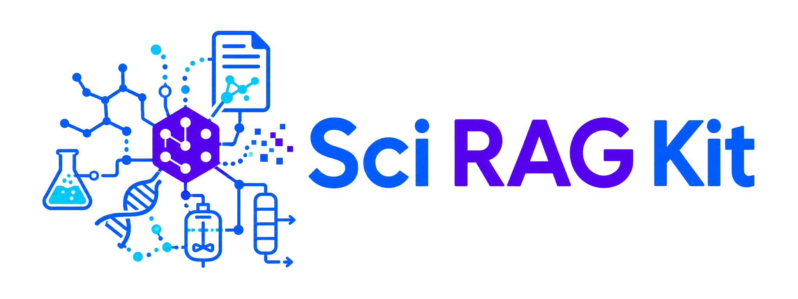
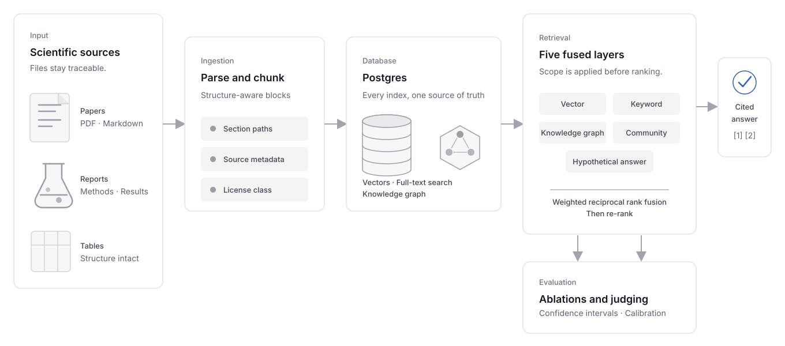

<section class="srag-home-section srag-home-masthead" markdown>

<div class="srag-home-masthead__brand">
  
  
</div>

# Retrieval-augmented generation, built around your scientific domain.

<div class="srag-home-masthead__lede" markdown>

Sci RAG Kit provides a blueprint for scientific RAG development, from document
ingestion, to knowledge graph generation, retrieval and evaluation. Fully
extensible and ready to serve over API and MCP.

</div>

</section>

<section class="srag-home-section" markdown>

<figure class="srag-home-figure">
  
  <figcaption>End-to-end RAG architecture that ships with Sci RAG Kit.</figcaption>
</figure>

</section>

<section class="srag-home-section" id="demo" markdown>

<!-- BEGIN KIT ONBOARDING: removed from generated projects by sci_rag.scaffold.apply -->

## Start a new project

Get started with two commands in the terminal. The setup wizard will ask a series
of questions and initialize configuration files around your answers:

```console title="Terminal"
$ pipx install sci-rag-kit
$ sci-rag new
```

Quick mode uses shipped defaults for models, parsing, reranking, infrastructure,
and licensing, and configures any LLM credentials you wish to provide. Choose
`Offline` for a credential-free first pass or `Advanced` for full customization.

<div id="srag-cast" class="srag-cast" data-cast="assets/casts/sci-rag-new.cast" data-autoplay="true" aria-label="Recorded sci-rag new session"></div>
<small> (A full trace of this terminal session can be found [below](#example))</small>

Prefer to read the code before creating a project? [Other entrypoints](quickstart.md#other-entrypoints) covers a clone, the GitHub template, `sci-rag init`, and the dev container. Every route ends at the same tree.

The [Quickstart](quickstart.md) goes from installation to a served knowledge
base in about ten minutes, and [How it works](learn.md) explains what is
happening at each step along the way.

<!-- END KIT ONBOARDING -->

</section>

<section class="srag-home-section" id="components" markdown>

## What's in the kit?

<div class="srag-defs" markdown>

Document ingestion: PDF, HTML, Markdown, and text files become passages
that keep their section headings and their tables intact, so a number
retrieved from "Table 3" still knows which experiment it belongs to.
[Follow a document into storage](architecture.md#data-model).

Five kinds of search: by meaning, by exact words, through a graph of the
field's concepts, through summaries of related concepts, and through a
model-written hypothetical answer. The model-dependent layers require a
credential. Their result lists merge into a single ranking that says which
layer found what. [See how a question is answered](learn.md#what-happens-to-a-question).

One database: passages, vectors, the full-text index, and the concept graph
all live in Postgres. That leaves one thing to run, one thing to back up,
and one place where a chunk and its graph entries commit together.
[Read why](adr/0001-graph-in-postgres.md).

Rights built in: every document carries a license class, and a request that
restricts rights never sees passages outside it, because the filter runs
inside each search before anything is ranked. [Read the rights
rules](methodology.md#7-scope-precedes-ranking).

Cited answers: with LLM provider credentials, every claim points at a numbered
passage. When the documents do not contain an answer, the kit says so rather
than filling the gap from a model's memory. [Use REST or MCP](api.md).

Measurement: a file of questions with known answers lets the kit score
retrieval, grade generated answers, and report what each search layer
contributes on the corpus at hand, so a change is judged by numbers rather
than by impression. [Evaluate your pipeline](evaluation.md).

</div>

</section>

<section class="srag-home-section" id="repository" markdown>

## Configure around your domain

Point the kit at a new domain by editing plain-text configuration. The domain's
concepts, prompt wording, and scoring questions all load at run time without
Python changes.

<!-- BEGIN KIT ONBOARDING -->
`pipx install sci-rag-kit` installs the kit. `sci-rag new` then fills in the
configuration files from the answers given during setup.
<!-- END KIT ONBOARDING -->

`domain/` holds everything specific to the domain: the concepts the graph
looks for, the prompt wording, and the test questions. `data/` holds the
documents themselves and a one-line-per-document manifest that records who
wrote each one and whether its text may be redistributed. Everything else
is the pipeline, and most projects never open it.

<pre class="srag-home-tree" aria-label="Annotated repository tree"><code>your-sci-rag/
├── domain/           the field: concepts, prompts, test questions
├── data/             the documents and their manifest
├── src/sci_rag/      the pipeline, from ingestion to serving
├── migrations/       database tables
├── tests/            runs offline
├── infra/terraform/  optional Google Cloud deployment
└── docs/             this site</code></pre>

[Project structure](get-started.md#project-structure) · [Bring your own domain](bring-your-own-domain.md)

</section>

<section class="srag-home-section" id="start" markdown>

## Where to start

<div class="srag-rows" markdown>

[<span class="srag-row__title">Quickstart</span><span class="srag-row__copy">Create a project, ingest the demo corpus, ask a question, and serve the result. About ten minutes.</span>](quickstart.md){ .srag-row }

[<span class="srag-row__title">Bring your own domain</span><span class="srag-row__copy">Seven commands from a folder of documents to a knowledge base that answers questions about them.</span>](bring-your-own-domain.md){ .srag-row }

[<span class="srag-row__title">How it works</span><span class="srag-row__copy">What happens between a document and a cited answer.</span>](learn.md){ .srag-row }

[<span class="srag-row__title">Evaluate your pipeline</span><span class="srag-row__copy">Measure retrieval and answers against questions with known answers, and see what each search layer contributes.</span>](evaluation.md){ .srag-row }

[<span class="srag-row__title">Run a corpus campaign</span><span class="srag-row__copy">Find papers by topic or DOI list, check their rights, and download the open-access PDFs.</span>](campaigns.md){ .srag-row }

[<span class="srag-row__title">FAQ</span><span class="srag-row__copy">Short answers to what this is, who it is for, and why it is built this way.</span>](faq.md){ .srag-row }

[<span class="srag-row__title">Choosing Sci RAG Kit</span><span class="srag-row__copy">How the kit compares with LightRAG, PaperQA2, LlamaIndex, and Microsoft GraphRAG.</span>](choosing-sci-rag-kit.md){ .srag-row }

</div>

</section>

<!-- BEGIN KIT ONBOARDING -->

<section class="srag-home-section" id="example" markdown>

## Example CLI Setup Wizard Session

The Quick session above, in full. `scripts/render_cast.py` builds it by driving the real setup wizard, so it cannot drift from what `sci-rag new` asks. `make cast` regenerates it, and `make docs` fails when it is stale.

<!-- BEGIN GENERATED TRANSCRIPT: scripts/render_cast.py -->

<div class="highlight srag-term">
<span class="filename">Terminal</span>
<pre><code><span class="srag-term__line srag-term__line--cmd"><span class="srag-term__prompt">$ </span><span class="srag-term__cmd">pipx install sci-rag-kit</span></span>
<span class="srag-term__line srag-term__line--cmd"><span class="srag-term__prompt">$ </span><span class="srag-term__cmd">sci-rag new</span></span>
<span class="srag-term__line srag-term__line--select srag-term__break"><span class="srag-term__heading">Select Setup</span></span>
<span class="srag-term__line srag-term__line--choice"><span class="srag-term__choice-n">1 - </span><span class="srag-term__choice">Quick - Six questions, sensible defaults for the rest</span></span>
<span class="srag-term__line srag-term__line--choice"><span class="srag-term__choice-n">2 - </span><span class="srag-term__choice">Advanced - Every option for full customization</span></span>
<span class="srag-term__line srag-term__line--choose"><span class="srag-term__key">Choose from [1/2] (1):</span><span class="srag-term__value"> 1</span></span>
<span class="srag-term__line srag-term__line--label srag-term__break"><span class="srag-term__status">What is your project called?</span></span>
<span class="srag-term__line srag-term__line--prompt"><span class="srag-term__key">project_name</span><span class="srag-term__default"> (My Scientific KB):</span><span class="srag-term__value"> Membrane Materials KB</span></span>
<span class="srag-term__line srag-term__line--label srag-term__break"><span class="srag-term__status">One line about your field</span></span>
<span class="srag-term__line srag-term__line--prompt"><span class="srag-term__key">description</span><span class="srag-term__default"> (A short description of your domain.):</span><span class="srag-term__value"> Membrane chemistry and performance for water treatment</span></span>
<span class="srag-term__line srag-term__line--label srag-term__break"><span class="srag-term__status">Contact email. Sent with each request to OpenAlex, Crossref, and Unpaywall, which serve identified callers faster. Blank is allowed.</span></span>
<span class="srag-term__line srag-term__line--prompt"><span class="srag-term__key">contact_email</span><span class="srag-term__default"> ():</span><span class="srag-term__value"> you@lbl.gov</span></span>
<span class="srag-term__line srag-term__line--select srag-term__break"><span class="srag-term__heading">Select environment_manager: Environment manager</span></span>
<span class="srag-term__line srag-term__line--choice"><span class="srag-term__choice-n">1 - </span><span class="srag-term__choice">uv: Fast Python environments and locking with uv</span></span>
<span class="srag-term__line srag-term__line--choice"><span class="srag-term__choice-n">2 - </span><span class="srag-term__choice">pixi: Conda packages and Python dependencies in one project</span></span>
<span class="srag-term__line srag-term__line--choice"><span class="srag-term__choice-n">3 - </span><span class="srag-term__choice">conda: A conventional conda environment plus pip dependencies</span></span>
<span class="srag-term__line srag-term__line--choice"><span class="srag-term__choice-n">4 - </span><span class="srag-term__choice">venv+pip: Standard-library virtual environment and pip</span></span>
<span class="srag-term__line srag-term__line--choose"><span class="srag-term__key">Choose from [1/2/3/4] (1):</span><span class="srag-term__value"> 1</span></span>
<span class="srag-term__line srag-term__line--select srag-term__break"><span class="srag-term__heading">Select credentials: How will you reach a model?</span></span>
<span class="srag-term__line srag-term__line--choice"><span class="srag-term__choice-n">1 - </span><span class="srag-term__choice">deepseek: DeepSeek generation with a dedicated API key</span></span>
<span class="srag-term__line srag-term__line--choice"><span class="srag-term__choice-n">2 - </span><span class="srag-term__choice">google_ai_studio: Shortest local setup; no manual Cloud setup</span></span>
<span class="srag-term__line srag-term__line--choice"><span class="srag-term__choice-n">3 - </span><span class="srag-term__choice">vertex_ai: Billed through a Google Cloud project you already have</span></span>
<span class="srag-term__line srag-term__line--choice"><span class="srag-term__choice-n">4 - </span><span class="srag-term__choice">offline: No model calls, graph extraction, or generated answers</span></span>
<span class="srag-term__line srag-term__line--choose"><span class="srag-term__key">Choose from [1/2/3/4] (1):</span><span class="srag-term__value"> 1</span></span>
<span class="srag-term__line srag-term__line--label srag-term__break"><span class="srag-term__status">DeepSeek API key. Create one in the DeepSeek platform. Blank to add it later.</span></span>
<span class="srag-term__line srag-term__line--prompt"><span class="srag-term__key">deepseek_api_key</span><span class="srag-term__default"> ():</span><span class="srag-term__value"></span></span>
<span class="srag-term__line srag-term__line--select srag-term__break"><span class="srag-term__heading">Select corpus_source: Where will the first documents come from?</span></span>
<span class="srag-term__line srag-term__line--choice"><span class="srag-term__choice-n">1 - </span><span class="srag-term__choice">local_files: Add PDFs, HTML, Markdown, or text files from disk</span></span>
<span class="srag-term__line srag-term__line--choice"><span class="srag-term__choice-n">2 - </span><span class="srag-term__choice">openalex_topic: Discover a legal corpus from an OpenAlex topic</span></span>
<span class="srag-term__line srag-term__line--choice"><span class="srag-term__choice-n">3 - </span><span class="srag-term__choice">doi_list: Resolve a list of known DOI records</span></span>
<span class="srag-term__line srag-term__line--choice"><span class="srag-term__choice-n">4 - </span><span class="srag-term__choice">demo_only: Keep the bundled synthetic corpus for evaluation</span></span>
<span class="srag-term__line srag-term__line--choose"><span class="srag-term__key">Choose from [1/2/3/4] (1):</span><span class="srag-term__value"> 1</span></span>
<span class="srag-term__line srag-term__line--output">Checking the credential with one small model request...</span>
<span class="srag-term__line srag-term__line--output">deepseek-flash check simulated for this recording; no model request sent.</span>
<span class="srag-term__line srag-term__line--empty"></span>
<span class="srag-term__line srag-term__line--status"><span class="srag-term__status">  Drafting an ontology for &quot;Membrane chemistry and performance for water treatment&quot;...</span></span>
<span class="srag-term__line srag-term__line--empty"></span>
<span class="srag-term__line srag-term__line--status"><span class="srag-term__status">  Entity types      Membrane, Material, Contaminant, Process, Property, Application, Organization, Standard</span></span>
<span class="srag-term__line srag-term__line--status"><span class="srag-term__status">  Relation types    MADE_OF, REMOVES, HAS_PROPERTY, USED_IN, REQUIRES, COMPARED_WITH</span></span>
<span class="srag-term__line srag-term__line--status"><span class="srag-term__status">  Query classes     performance, fabrication, fouling, application</span></span>
<span class="srag-term__line srag-term__line--empty"></span>
<span class="srag-term__line srag-term__line--status"><span class="srag-term__status">  Accept this ontology? [y/n/redraft] (y):</span></span>
<span class="srag-term__line srag-term__line--empty"></span>
<span class="srag-term__line srag-term__line--section"><span class="srag-term__heading">Fetching sci-rag-kit for membrane-materials-kb...</span></span>
<span class="srag-term__line srag-term__line--empty"></span>
<span class="srag-term__line srag-term__line--section"><span class="srag-term__heading">Writing membrane-materials-kb/</span></span>
<span class="srag-term__line srag-term__line--empty"></span>
<span class="srag-term__line srag-term__line--status"><span class="srag-term__status">  removed                docs/planning/, scripts/cloud_postgres.py, infra/terraform/dev-database/</span></span>
<span class="srag-term__line srag-term__line--status"><span class="srag-term__status">  domain/domain.yaml     8 entity types, 6 relation types, 4 query classes</span></span>
<span class="srag-term__line srag-term__line--status"><span class="srag-term__status">  data/demo/eval_seed_questions.jsonl   ground truth for the demo corpus</span></span>
<span class="srag-term__line srag-term__line--status"><span class="srag-term__status">  domain/eval_seed_questions.jsonl   guided blank</span></span>
<span class="srag-term__line srag-term__line--status"><span class="srag-term__status">  .env                   deepseek, deepseek-flash, Qwen/Qwen3-Embedding-0.6B</span></span>
<span class="srag-term__line srag-term__line--status"><span class="srag-term__status">  pyproject.toml         name, description, extras: modelscope-embedding, openai</span></span>
<span class="srag-term__line srag-term__line--status"><span class="srag-term__status">  Makefile               commands prefixed with `uv run`</span></span>
<span class="srag-term__line srag-term__line--status"><span class="srag-term__status">  docs/                  kit onboarding, player, and cast removed</span></span>
<span class="srag-term__line srag-term__line--status"><span class="srag-term__status">  Dockerfile             uv base image</span></span>
<span class="srag-term__line srag-term__line--status"><span class="srag-term__status">  .devcontainer/         ghcr.io/va-h/devcontainers-features/uv:1</span></span>
<span class="srag-term__line srag-term__line--status"><span class="srag-term__status">  rendered               6 files for uv</span></span>
<span class="srag-term__line srag-term__line--status"><span class="srag-term__status">  data/corpus.jsonl      commented field shape, ready for your documents</span></span>
<span class="srag-term__line srag-term__line--status"><span class="srag-term__status">  LICENSE                BSD-3-Clause</span></span>
<span class="srag-term__line srag-term__line--status"><span class="srag-term__status">  README.md              rewritten opening</span></span>
<span class="srag-term__line srag-term__line--status"><span class="srag-term__status">  git                    initialized, 1 commit</span></span>
<span class="srag-term__line srag-term__line--empty"></span>
<span class="srag-term__line srag-term__line--done"><span class="srag-term__heading">Done. Membrane Materials KB is set up. Next:</span></span>
<span class="srag-term__line srag-term__line--empty"></span>
<span class="srag-term__line srag-term__line--next"><span class="srag-term__cmd">  cd membrane-materials-kb</span></span>
<span class="srag-term__line srag-term__line--next"><span class="srag-term__cmd">  make setup                # install, start Postgres, create the tables</span></span>
<span class="srag-term__line srag-term__line--next"><span class="srag-term__cmd">  uv run sci-rag doctor</span></span>
<span class="srag-term__line srag-term__line--next"><span class="srag-term__cmd">  # copy your PDFs, HTML, Markdown, or text files into data/raw/</span></span>
<span class="srag-term__line srag-term__line--next"><span class="srag-term__cmd">  uv run sci-rag build data/raw</span></span>
<span class="srag-term__line srag-term__line--next"><span class="srag-term__cmd">  uv run sci-rag answer &quot;a question in your field&quot;</span></span>
<span class="srag-term__line srag-term__line--empty"></span>
<span class="srag-term__line srag-term__line--output">Then let a model draft the rest of your domain files:</span>
<span class="srag-term__line srag-term__line--empty"></span>
<span class="srag-term__line srag-term__line--next"><span class="srag-term__cmd">  uv run sci-rag draft manifest --folder data/raw</span></span>
<span class="srag-term__line srag-term__line--next"><span class="srag-term__cmd">  uv run sci-rag draft ontology --from-corpus</span></span>
<span class="srag-term__line srag-term__line--next"><span class="srag-term__cmd">  uv run sci-rag draft questions --count 10</span></span>
<span class="srag-term__line srag-term__line--empty"></span>
<span class="srag-term__line srag-term__line--output">Each command proposes a file for review. Add --print-prompt to copy its prompt into an assistant you already use.</span>
<span class="srag-term__line srag-term__line--empty"></span>
<span class="srag-term__line srag-term__line--output">The walkthrough: docs/bring-your-own-domain.md</span>
</code></pre>
</div>

<details markdown>
<summary>Show the Advanced setup</summary>

<div class="highlight srag-term">
<span class="filename">Terminal</span>
<pre><code><span class="srag-term__line srag-term__line--cmd"><span class="srag-term__prompt">$ </span><span class="srag-term__cmd">pipx install sci-rag-kit</span></span>
<span class="srag-term__line srag-term__line--cmd"><span class="srag-term__prompt">$ </span><span class="srag-term__cmd">sci-rag new</span></span>
<span class="srag-term__line srag-term__line--select srag-term__break"><span class="srag-term__heading">Select Setup</span></span>
<span class="srag-term__line srag-term__line--choice"><span class="srag-term__choice-n">1 - </span><span class="srag-term__choice">Quick - Six questions, sensible defaults for the rest</span></span>
<span class="srag-term__line srag-term__line--choice"><span class="srag-term__choice-n">2 - </span><span class="srag-term__choice">Advanced - Every option for full customization</span></span>
<span class="srag-term__line srag-term__line--choose"><span class="srag-term__key">Choose from [1/2] (1):</span><span class="srag-term__value"> 2</span></span>
<span class="srag-term__line srag-term__line--label srag-term__break"><span class="srag-term__status">What is your project called?</span></span>
<span class="srag-term__line srag-term__line--prompt"><span class="srag-term__key">project_name</span><span class="srag-term__default"> (My Scientific KB):</span><span class="srag-term__value"> Membrane Materials KB</span></span>
<span class="srag-term__line srag-term__line--label srag-term__break"><span class="srag-term__status">Repository directory name</span></span>
<span class="srag-term__line srag-term__line--prompt"><span class="srag-term__key">repo_name</span><span class="srag-term__default"> (membrane-materials-kb):</span><span class="srag-term__value"></span></span>
<span class="srag-term__line srag-term__line--label srag-term__break"><span class="srag-term__status">One line about your field</span></span>
<span class="srag-term__line srag-term__line--prompt"><span class="srag-term__key">description</span><span class="srag-term__default"> (A short description of your domain.):</span><span class="srag-term__value"> Membrane chemistry and performance for water treatment</span></span>
<span class="srag-term__line srag-term__line--label srag-term__break"><span class="srag-term__status">Who should the project credit?</span></span>
<span class="srag-term__line srag-term__line--prompt"><span class="srag-term__key">author_name</span><span class="srag-term__default"> (Your name, lab, or organization):</span><span class="srag-term__value"> Berkeley Lab</span></span>
<span class="srag-term__line srag-term__line--label srag-term__break"><span class="srag-term__status">Contact email. Sent with each request to OpenAlex, Crossref, and Unpaywall, which serve identified callers faster. Blank is allowed.</span></span>
<span class="srag-term__line srag-term__line--prompt"><span class="srag-term__key">contact_email</span><span class="srag-term__default"> ():</span><span class="srag-term__value"> you@lbl.gov</span></span>
<span class="srag-term__line srag-term__line--label srag-term__break"><span class="srag-term__status">Python version</span></span>
<span class="srag-term__line srag-term__line--prompt"><span class="srag-term__key">python_version</span><span class="srag-term__default"> (3.12):</span><span class="srag-term__value"></span></span>
<span class="srag-term__line srag-term__line--select srag-term__break"><span class="srag-term__heading">Select environment_manager: Environment manager</span></span>
<span class="srag-term__line srag-term__line--choice"><span class="srag-term__choice-n">1 - </span><span class="srag-term__choice">uv: Fast Python environments and locking with uv</span></span>
<span class="srag-term__line srag-term__line--choice"><span class="srag-term__choice-n">2 - </span><span class="srag-term__choice">pixi: Conda packages and Python dependencies in one project</span></span>
<span class="srag-term__line srag-term__line--choice"><span class="srag-term__choice-n">3 - </span><span class="srag-term__choice">conda: A conventional conda environment plus pip dependencies</span></span>
<span class="srag-term__line srag-term__line--choice"><span class="srag-term__choice-n">4 - </span><span class="srag-term__choice">venv+pip: Standard-library virtual environment and pip</span></span>
<span class="srag-term__line srag-term__line--choose"><span class="srag-term__key">Choose from [1/2/3/4] (1):</span><span class="srag-term__value"> 2</span></span>
<span class="srag-term__line srag-term__line--select srag-term__break"><span class="srag-term__heading">Select dependency_file: Where should pixi dependencies live?</span></span>
<span class="srag-term__line srag-term__line--choice"><span class="srag-term__choice-n">1 - </span><span class="srag-term__choice">pyproject.toml: Keep project and pixi dependencies together</span></span>
<span class="srag-term__line srag-term__line--choice"><span class="srag-term__choice-n">2 - </span><span class="srag-term__choice">pixi.toml: Keep pixi configuration in its own file</span></span>
<span class="srag-term__line srag-term__line--choose"><span class="srag-term__key">Choose from [1/2] (1):</span><span class="srag-term__value"></span></span>
<span class="srag-term__line srag-term__line--select srag-term__break"><span class="srag-term__heading">Select credentials: How will you reach a model?</span></span>
<span class="srag-term__line srag-term__line--choice"><span class="srag-term__choice-n">1 - </span><span class="srag-term__choice">deepseek: DeepSeek generation with a dedicated API key</span></span>
<span class="srag-term__line srag-term__line--choice"><span class="srag-term__choice-n">2 - </span><span class="srag-term__choice">google_ai_studio: Shortest local setup; no manual Cloud setup</span></span>
<span class="srag-term__line srag-term__line--choice"><span class="srag-term__choice-n">3 - </span><span class="srag-term__choice">vertex_ai: Billed through a Google Cloud project you already have</span></span>
<span class="srag-term__line srag-term__line--choice"><span class="srag-term__choice-n">4 - </span><span class="srag-term__choice">offline: No model calls, graph extraction, or generated answers</span></span>
<span class="srag-term__line srag-term__line--choose"><span class="srag-term__key">Choose from [1/2/3/4] (1):</span><span class="srag-term__value"> 1</span></span>
<span class="srag-term__line srag-term__line--label srag-term__break"><span class="srag-term__status">DeepSeek API key. Create one in the DeepSeek platform. Blank to add it later.</span></span>
<span class="srag-term__line srag-term__line--prompt"><span class="srag-term__key">deepseek_api_key</span><span class="srag-term__default"> ():</span><span class="srag-term__value"></span></span>
<span class="srag-term__line srag-term__line--select srag-term__break"><span class="srag-term__heading">Select embedding_provider: Embedding provider</span></span>
<span class="srag-term__line srag-term__line--choice"><span class="srag-term__choice-n">1 - </span><span class="srag-term__choice">modelscope: Local Qwen3 embeddings downloaded through ModelScope</span></span>
<span class="srag-term__line srag-term__line--choice"><span class="srag-term__choice-n">2 - </span><span class="srag-term__choice">google: Semantic embeddings from the configured Google model</span></span>
<span class="srag-term__line srag-term__line--choice"><span class="srag-term__choice-n">3 - </span><span class="srag-term__choice">local-hash: Deterministic offline vectors for development and tests</span></span>
<span class="srag-term__line srag-term__line--choose"><span class="srag-term__key">Choose from [1/2/3] (1):</span><span class="srag-term__value"></span></span>
<span class="srag-term__line srag-term__line--label srag-term__break"><span class="srag-term__status">Generation model</span></span>
<span class="srag-term__line srag-term__line--prompt"><span class="srag-term__key">llm_model</span><span class="srag-term__default"> (deepseek-flash):</span><span class="srag-term__value"></span></span>
<span class="srag-term__line srag-term__line--label srag-term__break"><span class="srag-term__status">Embedding model</span></span>
<span class="srag-term__line srag-term__line--prompt"><span class="srag-term__key">embedding_model</span><span class="srag-term__default"> (Qwen/Qwen3-Embedding-0.6B):</span><span class="srag-term__value"></span></span>
<span class="srag-term__line srag-term__line--label srag-term__break"><span class="srag-term__status">Embedding dimensions</span></span>
<span class="srag-term__line srag-term__line--prompt"><span class="srag-term__key">embedding_dim</span><span class="srag-term__default"> (1024):</span><span class="srag-term__value"></span></span>
<span class="srag-term__line srag-term__line--select srag-term__break"><span class="srag-term__heading">Select ontology: Starting ontology</span></span>
<span class="srag-term__line srag-term__line--choice"><span class="srag-term__choice-n">1 - </span><span class="srag-term__choice">draft_with_llm: Draft field-specific types from your description</span></span>
<span class="srag-term__line srag-term__line--choice"><span class="srag-term__choice-n">2 - </span><span class="srag-term__choice">keep_demo_example: Keep the worked agricultural-residue ontology for now</span></span>
<span class="srag-term__line srag-term__line--choice"><span class="srag-term__choice-n">3 - </span><span class="srag-term__choice">blank: Start with an intentionally empty ontology</span></span>
<span class="srag-term__line srag-term__line--choose"><span class="srag-term__key">Choose from [1/2/3] (1):</span><span class="srag-term__value"> 1</span></span>
<span class="srag-term__line srag-term__line--select srag-term__break"><span class="srag-term__heading">Select corpus_source: Where will the first documents come from?</span></span>
<span class="srag-term__line srag-term__line--choice"><span class="srag-term__choice-n">1 - </span><span class="srag-term__choice">local_files: Add PDFs, HTML, Markdown, or text files from disk</span></span>
<span class="srag-term__line srag-term__line--choice"><span class="srag-term__choice-n">2 - </span><span class="srag-term__choice">openalex_topic: Discover a legal corpus from an OpenAlex topic</span></span>
<span class="srag-term__line srag-term__line--choice"><span class="srag-term__choice-n">3 - </span><span class="srag-term__choice">doi_list: Resolve a list of known DOI records</span></span>
<span class="srag-term__line srag-term__line--choice"><span class="srag-term__choice-n">4 - </span><span class="srag-term__choice">demo_only: Keep the bundled synthetic corpus for evaluation</span></span>
<span class="srag-term__line srag-term__line--choose"><span class="srag-term__key">Choose from [1/2/3/4] (1):</span><span class="srag-term__value"> 2</span></span>
<span class="srag-term__line srag-term__line--label srag-term__break"><span class="srag-term__status">OpenAlex topic</span></span>
<span class="srag-term__line srag-term__line--prompt"><span class="srag-term__key">openalex_topic</span><span class="srag-term__default"> (your topic):</span><span class="srag-term__value"> polyamide membrane fouling</span></span>
<span class="srag-term__line srag-term__line--label srag-term__break"><span class="srag-term__status">Maximum OpenAlex results</span></span>
<span class="srag-term__line srag-term__line--prompt"><span class="srag-term__key">max_results</span><span class="srag-term__default"> (100):</span><span class="srag-term__value"> 250</span></span>
<span class="srag-term__line srag-term__line--select srag-term__break"><span class="srag-term__heading">Select pdf_parser: PDF parser</span></span>
<span class="srag-term__line srag-term__line--choice"><span class="srag-term__choice-n">1 - </span><span class="srag-term__choice">pypdf: Lightweight text extraction with no machine-learning stack</span></span>
<span class="srag-term__line srag-term__line--choice"><span class="srag-term__choice-n">2 - </span><span class="srag-term__choice">docling: Structure-aware parsing with stronger table extraction</span></span>
<span class="srag-term__line srag-term__line--choose"><span class="srag-term__key">Choose from [1/2] (1):</span><span class="srag-term__value"> 2</span></span>
<span class="srag-term__line srag-term__line--select srag-term__break"><span class="srag-term__heading">Select reranker: Result reranker</span></span>
<span class="srag-term__line srag-term__line--choice"><span class="srag-term__choice-n">1 - </span><span class="srag-term__choice">none: Return the fused ranking as-is</span></span>
<span class="srag-term__line srag-term__line--choice"><span class="srag-term__choice-n">2 - </span><span class="srag-term__choice">llm: Ask the configured model to reorder retrieved passages</span></span>
<span class="srag-term__line srag-term__line--choice"><span class="srag-term__choice-n">3 - </span><span class="srag-term__choice">local_cross_encoder: Run a local cross-encoder model</span></span>
<span class="srag-term__line srag-term__line--choose"><span class="srag-term__key">Choose from [1/2/3] (1):</span><span class="srag-term__value"></span></span>
<span class="srag-term__line srag-term__line--select srag-term__break"><span class="srag-term__heading">Select include_terraform: Keep production Terraform?</span></span>
<span class="srag-term__line srag-term__line--choice"><span class="srag-term__choice-n">1 - </span><span class="srag-term__choice">Yes: Keep the optional Cloud Run and Cloud SQL deployment module</span></span>
<span class="srag-term__line srag-term__line--choice"><span class="srag-term__choice-n">2 - </span><span class="srag-term__choice">No: Remove production infrastructure files and their CI job</span></span>
<span class="srag-term__line srag-term__line--choose"><span class="srag-term__key">Choose from [1/2] (1):</span><span class="srag-term__value"> 2</span></span>
<span class="srag-term__line srag-term__line--select srag-term__break"><span class="srag-term__heading">Select include_cloud_database: Include the Cloud SQL development helper? Include the opt-in Cloud SQL development helper and Terraform module.</span></span>
<span class="srag-term__line srag-term__line--choice"><span class="srag-term__choice-n">1 - </span><span class="srag-term__choice">Yes: Keep the opt-in shared development database helper</span></span>
<span class="srag-term__line srag-term__line--choice"><span class="srag-term__choice-n">2 - </span><span class="srag-term__choice">No: Use Docker, conda-forge, or another PostgreSQL server</span></span>
<span class="srag-term__line srag-term__line--choose"><span class="srag-term__key">Choose from [1/2] (2):</span><span class="srag-term__value"></span></span>
<span class="srag-term__line srag-term__line--select srag-term__break"><span class="srag-term__heading">Select include_demo_corpus: Keep the demo corpus?</span></span>
<span class="srag-term__line srag-term__line--choice"><span class="srag-term__choice-n">1 - </span><span class="srag-term__choice">Yes: Keep five synthetic documents for a known-good first run</span></span>
<span class="srag-term__line srag-term__line--choice"><span class="srag-term__choice-n">2 - </span><span class="srag-term__choice">No: Remove the demo and examples from the generated project</span></span>
<span class="srag-term__line srag-term__line--choose"><span class="srag-term__key">Choose from [1/2] (1):</span><span class="srag-term__value"> 2</span></span>
<span class="srag-term__line srag-term__line--select srag-term__break"><span class="srag-term__heading">Select open_source_license: Open-source license</span></span>
<span class="srag-term__line srag-term__line--choice"><span class="srag-term__choice-n">1 - </span><span class="srag-term__choice">BSD-3-Clause: Permissive license with non-endorsement protection</span></span>
<span class="srag-term__line srag-term__line--choice"><span class="srag-term__choice-n">2 - </span><span class="srag-term__choice">MIT: Short permissive license</span></span>
<span class="srag-term__line srag-term__line--choice"><span class="srag-term__choice-n">3 - </span><span class="srag-term__choice">Apache-2.0: Permissive license with an explicit patent grant</span></span>
<span class="srag-term__line srag-term__line--choice"><span class="srag-term__choice-n">4 - </span><span class="srag-term__choice">No license file: Do not grant redistribution rights yet</span></span>
<span class="srag-term__line srag-term__line--choose"><span class="srag-term__key">Choose from [1/2/3/4] (1):</span><span class="srag-term__value"></span></span>
<span class="srag-term__line srag-term__line--select srag-term__break"><span class="srag-term__heading">Select initialize_git: Initialize a Git repository?</span></span>
<span class="srag-term__line srag-term__line--choice"><span class="srag-term__choice-n">1 - </span><span class="srag-term__choice">Yes: Create a repository and make the generated baseline commit</span></span>
<span class="srag-term__line srag-term__line--choice"><span class="srag-term__choice-n">2 - </span><span class="srag-term__choice">No: Leave version-control setup to you</span></span>
<span class="srag-term__line srag-term__line--choose"><span class="srag-term__key">Choose from [1/2] (1):</span><span class="srag-term__value"></span></span>
<span class="srag-term__line srag-term__line--select srag-term__break"><span class="srag-term__heading">Select draft_domain_files: Draft the remaining domain files next?</span></span>
<span class="srag-term__line srag-term__line--choice"><span class="srag-term__choice-n">1 - </span><span class="srag-term__choice">Yes: Put the corpus-grounded drafting commands in next steps</span></span>
<span class="srag-term__line srag-term__line--choice"><span class="srag-term__choice-n">2 - </span><span class="srag-term__choice">No: Point next steps at the hand-written route</span></span>
<span class="srag-term__line srag-term__line--choose"><span class="srag-term__key">Choose from [1/2] (1):</span><span class="srag-term__value"></span></span>
<span class="srag-term__line srag-term__line--output">Checking the credential with one small model request...</span>
<span class="srag-term__line srag-term__line--output">deepseek-flash check simulated for this recording; no model request sent.</span>
<span class="srag-term__line srag-term__line--empty"></span>
<span class="srag-term__line srag-term__line--status"><span class="srag-term__status">  Drafting an ontology for &quot;Membrane chemistry and performance for water treatment&quot;...</span></span>
<span class="srag-term__line srag-term__line--empty"></span>
<span class="srag-term__line srag-term__line--status"><span class="srag-term__status">  Entity types      Membrane, Material, Contaminant, Process, Property, Application, Organization, Standard</span></span>
<span class="srag-term__line srag-term__line--status"><span class="srag-term__status">  Relation types    MADE_OF, REMOVES, HAS_PROPERTY, USED_IN, REQUIRES, COMPARED_WITH</span></span>
<span class="srag-term__line srag-term__line--status"><span class="srag-term__status">  Query classes     performance, fabrication, fouling, application</span></span>
<span class="srag-term__line srag-term__line--empty"></span>
<span class="srag-term__line srag-term__line--status"><span class="srag-term__status">  Accept this ontology? [y/n/redraft] (y):</span></span>
<span class="srag-term__line srag-term__line--empty"></span>
<span class="srag-term__line srag-term__line--section"><span class="srag-term__heading">Fetching sci-rag-kit for membrane-materials-kb...</span></span>
<span class="srag-term__line srag-term__line--empty"></span>
<span class="srag-term__line srag-term__line--section"><span class="srag-term__heading">Writing membrane-materials-kb/</span></span>
<span class="srag-term__line srag-term__line--empty"></span>
<span class="srag-term__line srag-term__line--status"><span class="srag-term__status">  removed                docs/planning/, infra/terraform/, scripts/cloud_postgres.py, infra/terraform/dev-database/, data/demo/, examples/, scripts/graph_replay.py, tests/unit/test_graph_replay_contract.py, tests/integration/test_graph_replay.py, tests/unit/test_graph_replay_makefile.py, tests/unit/test_graph_replay_scaffold.py, docs/adr/0011-committed-benchmark-graph-replay.md</span></span>
<span class="srag-term__line srag-term__line--status"><span class="srag-term__status">  domain/domain.yaml     8 entity types, 6 relation types, 4 query classes</span></span>
<span class="srag-term__line srag-term__line--status"><span class="srag-term__status">  domain/eval_seed_questions.jsonl   guided blank</span></span>
<span class="srag-term__line srag-term__line--status"><span class="srag-term__status">  .env                   deepseek, deepseek-flash, Qwen/Qwen3-Embedding-0.6B</span></span>
<span class="srag-term__line srag-term__line--status"><span class="srag-term__status">  pyproject.toml         name, description, extras: modelscope-embedding, openai, docling</span></span>
<span class="srag-term__line srag-term__line--status"><span class="srag-term__status">  Makefile               commands prefixed with `pixi run`, database defaults to conda-forge, no Docker needed</span></span>
<span class="srag-term__line srag-term__line--status"><span class="srag-term__status">  docs/                  kit onboarding, player, and cast removed</span></span>
<span class="srag-term__line srag-term__line--status"><span class="srag-term__status">  pyproject.toml          workspace, environments, tasks</span></span>
<span class="srag-term__line srag-term__line--status"><span class="srag-term__status">  Dockerfile             pixi base image</span></span>
<span class="srag-term__line srag-term__line--status"><span class="srag-term__status">  .devcontainer/         ghcr.io/prefix-dev/devcontainer-features/pixi:0</span></span>
<span class="srag-term__line srag-term__line--status"><span class="srag-term__status">  rendered               9 files for pixi</span></span>
<span class="srag-term__line srag-term__line--status"><span class="srag-term__status">  pixi.lock              created on first `pixi install`</span></span>
<span class="srag-term__line srag-term__line--status"><span class="srag-term__status">  data/campaigns/        openalex topic &quot;polyamide membrane fouling&quot;</span></span>
<span class="srag-term__line srag-term__line--status"><span class="srag-term__status">  LICENSE                BSD-3-Clause</span></span>
<span class="srag-term__line srag-term__line--status"><span class="srag-term__status">  README.md              rewritten opening</span></span>
<span class="srag-term__line srag-term__line--status"><span class="srag-term__status">  git                    initialized, 1 commit</span></span>
<span class="srag-term__line srag-term__line--empty"></span>
<span class="srag-term__line srag-term__line--done"><span class="srag-term__heading">Done. Membrane Materials KB is set up. Next:</span></span>
<span class="srag-term__line srag-term__line--empty"></span>
<span class="srag-term__line srag-term__line--next"><span class="srag-term__cmd">  cd membrane-materials-kb</span></span>
<span class="srag-term__line srag-term__line--next"><span class="srag-term__cmd">  make setup                # install, start Postgres, create the tables</span></span>
<span class="srag-term__line srag-term__line--next"><span class="srag-term__cmd">  pixi run sci-rag doctor</span></span>
<span class="srag-term__line srag-term__line--next"><span class="srag-term__cmd">  make corpus               # discover papers and write data/corpus.jsonl</span></span>
<span class="srag-term__line srag-term__line--next"><span class="srag-term__cmd">  pixi run sci-rag build --manifest data/corpus.jsonl</span></span>
<span class="srag-term__line srag-term__line--next"><span class="srag-term__cmd">  pixi run sci-rag answer &quot;a question in your field&quot;</span></span>
<span class="srag-term__line srag-term__line--empty"></span>
<span class="srag-term__line srag-term__line--output">Then let a model draft the rest of your domain files:</span>
<span class="srag-term__line srag-term__line--empty"></span>
<span class="srag-term__line srag-term__line--next"><span class="srag-term__cmd">  pixi run sci-rag draft manifest --folder data/raw</span></span>
<span class="srag-term__line srag-term__line--next"><span class="srag-term__cmd">  pixi run sci-rag draft ontology --from-corpus</span></span>
<span class="srag-term__line srag-term__line--next"><span class="srag-term__cmd">  pixi run sci-rag draft questions --count 10</span></span>
<span class="srag-term__line srag-term__line--empty"></span>
<span class="srag-term__line srag-term__line--output">Each command proposes a file for review. Add --print-prompt to copy its prompt into an assistant you already use.</span>
<span class="srag-term__line srag-term__line--empty"></span>
<span class="srag-term__line srag-term__line--output">The walkthrough: docs/bring-your-own-domain.md</span>
</code></pre>
</div>

</details>

<!-- END GENERATED TRANSCRIPT -->

</section>

<!-- END KIT ONBOARDING -->
